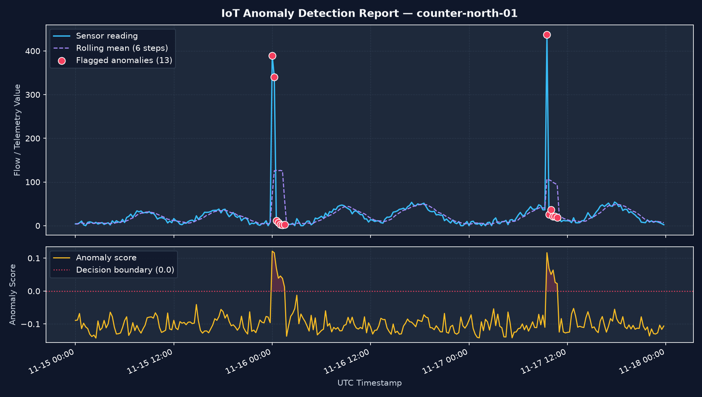
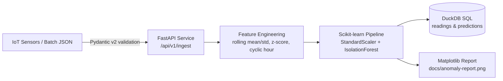

# IoT Anomaly Detection Pipeline — Python · Scikit-learn · DuckDB · FastAPI

[](https://github.com/Marin-Weis/iot-anomaly-pipeline/actions/workflows/ci.yml)

End-to-end **Data & ML telemetry pipeline** for IoT flow counters and sensor time-series: strict **Pydantic v2** payload validation, **Pandas/NumPy** rolling feature engineering, **Scikit-learn `IsolationForest`** anomaly scoring, embedded **DuckDB** SQL persistence, **FastAPI** inference endpoints, and automated **Matplotlib** visual reporting.



## Architecture



### Key Technical Features
- **Strict Input Validation (`schemas.py`)**: Pydantic v2 enforces sensor ID format, bounded telemetry ranges (`[0, 100000]`), battery/RSSI bounds, and finite-value checks before any feature computation.
- **Time-Series Feature Engineering (`features.py`)**: Computes per-sensor 6-step rolling mean, rolling standard deviation, local z-score, first-order delta, and cyclic time encodings (`hour_sin`, `hour_cos`).
- **Unsupervised ML Scoring (`model.py`)**: Trains a `StandardScaler + IsolationForest` pipeline on clean diurnal baseline data and classifies anomalies into `NORMAL`, `WARNING`, and `CRITICAL` severity levels.
- **Embedded Analytical SQL (`storage.py`)**: Stores raw telemetry and scored predictions in **DuckDB** (`INSERT OR REPLACE` idempotency) and exposes SQL aggregation queries (`/api/v1/sensors/{id}/summary`, `/api/v1/anomalies`).
- **Visual Reporting (`report.py`)**: Generates a high-DPI dark-theme chart overlaying sensor readings, rolling baseline, flagged anomalies, and the Isolation Forest decision boundary.

## Quick Start

```bash
make setup    # create venv and install dependencies
make test     # run ruff + pytest suite
make demo     # train model, score 3-day test batch, store in DuckDB, render report PNG
make serve    # start FastAPI + Swagger UI on http://localhost:8083/docs
```

### Docker
```bash
docker build -t iot-anomaly-pipeline:latest .
docker run --rm -p 8083:8083 iot-anomaly-pipeline:latest
```

## API Endpoints

| Method | Path | Description |
|---|---|---|
| `GET` | `/health` | Service and model readiness check |
| `POST` | `/api/v1/train` | Re-train Isolation Forest on baseline telemetry |
| `POST` | `/api/v1/ingest` | Validate, score, and persist a batch of sensor readings |
| `GET` | `/api/v1/anomalies` | List flagged anomalies (filterable by `sensor_id`) |
| `GET` | `/api/v1/sensors/{sensor_id}/summary` | Aggregate SQL stats (count, anomaly rate, avg/max) |
| `GET` | `/docs` | Interactive OpenAPI / Swagger UI |

## Repository Layout

```
.
├── src/iot_pipeline/
│   ├── api.py          # FastAPI endpoints & lifecycle
│   ├── features.py     # Rolling & cyclic time-series features
│   ├── generator.py    # Synthetic diurnal IoT counter generator
│   ├── model.py        # StandardScaler + IsolationForest wrapper
│   ├── report.py       # Matplotlib visual anomaly report
│   ├── schemas.py      # Pydantic v2 validation models
│   └── storage.py      # DuckDB analytical SQL storage
├── scripts/
│   └── run_demo.py     # End-to-end demo & report generation
├── tests/
│   └── test_pipeline.py
├── Dockerfile
├── Makefile
└── .github/workflows/ci.yml
```

## License
MIT
